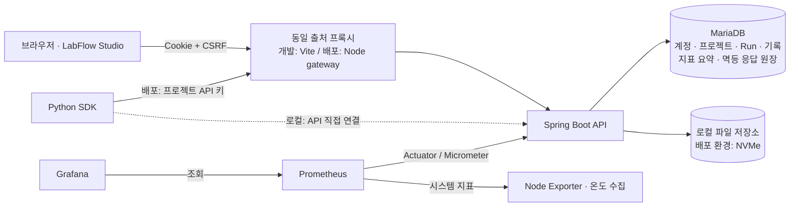

# LabFlow

Python 실험의 설정·지표·로그·파일을 기록하고, 웹에서 실행 결과를 조회·비교하는 실험 추적 프로젝트입니다.

실험은 사용자의 Python 코드에서 실행합니다. LabFlow는 SDK로 실험 데이터를 수집하고, 프로젝트와 실행 단위인 **Run**을 기준으로 보관합니다. 웹 클라이언트 **LabFlow Studio**에서 실행 상태, 지표 변화, 파라미터 차이와 결과 파일을 확인할 수 있습니다.

## 목차

- [주요 기능](#주요-기능)
- [시스템 구조](#시스템-구조)
- [기술 스택](#기술-스택)
- [디렉터리 구조](#디렉터리-구조)
- [로컬 실행](#로컬-실행)
- [SDK 사용법](#sdk-사용법)
- [테스트](#테스트)
- [배포와 모니터링](#배포와-모니터링)
- [설계·검증 문서](#설계검증-문서)

## 주요 기능

| 기능 | 내용 |
| --- | --- |
| 계정·인증 | 이메일 인증, 로그인, HttpOnly 인증 쿠키, refresh 토큰 회전, CSRF 검증 |
| 프로젝트 | 개인 프로젝트 생성·수정·삭제, `PRIVATE` / `PUBLIC` 공개 범위 |
| 프로젝트 API 키 | SDK용 키 발급·폐기, 프로젝트 및 소유자 권한 검증 |
| Run 추적 | 생성, 실행 상태, 파라미터, 메타데이터, 완료·실패 기록 |
| 실험 데이터 | 숫자 메트릭, 로그, 텍스트, CPU/RAM·선택적 NVIDIA GPU 지표 |
| 웹 조회·비교 | 검색·정렬·페이지 조회, 최신 지표 요약, Run 2~4개 비교, 기록 커서 탐색 |
| Artifact | 파일 업로드·다운로드, SHA-256 검증, 기록 JSON 내보내기 |
| 자동 수집 | SDK의 stdout/stderr 수집, 시스템 지표·Heartbeat 주기 전송 |
| 재전송 | `Idempotency-Key` 기반 중복 방지, 자동 출력 로그의 로컬 보관·복구 |
| 관측·검증 | Actuator·Micrometer·Prometheus·Grafana, k6 부하 및 저장 정합성 검증 |

현재 프로젝트는 개인 소유 모델입니다. 팀·공동 작업 권한 관리는 구현하지 않았습니다. Heartbeat가 끊기면 연결 상태를 표시하며, 이를 근거로 Run을 자동 실패 처리하지 않습니다.

## 시스템 구조



### 데이터 흐름

1. 웹에서 프로젝트를 만들고 프로젝트 API 키를 발급합니다.
2. SDK가 API 키로 Run을 생성하고 파라미터·메트릭·로그·파일을 전송합니다. 프로젝트는 API 키로 결정됩니다.
3. 메트릭 원본과 지표별 요약을 같은 DB 트랜잭션으로 저장합니다. 웹의 요약 조회는 전체 이력 대신 요약 테이블과 해당 원본을 읽습니다.
4. Studio는 실행 중인 Run의 요약을 응답 완료 후 5초 간격으로 조회합니다. 모두 종료되면 최종 값을 읽고 요약 polling을 멈춥니다. 원본 기록은 별도의 커서 API로 탐색합니다.
5. 파일 본문은 DB 트랜잭션 밖에서 스트리밍하고, 예약·완료 메타데이터는 짧은 트랜잭션으로 처리합니다.

### 주요 설계

- **저장 모델:** 사용자·프로젝트·권한·실험 기록의 관계와 트랜잭션을 MariaDB에서 관리합니다. 누적 이력을 반복 집계하는 조회에는 별도 요약 테이블을 사용합니다.
- **멱등성:** 도메인 엔티티와 분리된 `idempotency_request` 원장에서 요청 상태와 최초 응답을 관리합니다. 업무 데이터와 성공 응답을 함께 커밋하며, SDK는 재시도에 같은 키와 본문을 사용합니다.
- **인증 분리:** 웹은 쿠키와 CSRF, SDK는 프로젝트 Bearer API 키를 사용합니다. 응답 재생 전에도 현재 키·소유자 권한을 검증합니다.
- **웹 세션:** 동일 출처의 여러 탭이 토큰 갱신을 조정하며, 64비트 ID를 JavaScript 숫자로 반올림하지 않도록 처리합니다.

## 기술 스택

| 영역 | 기술 |
| --- | --- |
| Backend | Java 21, Spring Boot 4.1.1, Spring MVC, Spring Security, JPA/Hibernate |
| DB·스키마 | MariaDB 11.8 검증 환경, Flyway V1~V3, H2 테스트 DB |
| Frontend | React 19, TypeScript 6, Vite 8, Node.js 24 이상 |
| SDK | Python 3.10 이상, `labflow-sdk` 0.4.0, httpx, psutil, SQLite 로그 보관 |
| 테스트 | JUnit, Spring Boot Test, pytest, Playwright, Node.js Test Runner, k6 |
| 관측·운영 | Actuator, Micrometer, Prometheus, Grafana, Node Exporter, Raspberry Pi·NVMe·systemd |

## 디렉터리 구조

```text
.
├── backend/                 # Spring Boot API 및 테스트
│   ├── src/main/java/com/dju/labflow/
│   │   ├── auth/            # 로그인·토큰·이메일 인증
│   │   ├── user/            # 사용자
│   │   ├── project/         # 프로젝트·프로젝트 API 키
│   │   ├── run/             # Run·지표·로그·텍스트·파일·요약
│   │   ├── sdk/             # SDK HTTP API·공통 멱등 원장
│   │   ├── admin/           # 관리자 API
│   │   └── global/          # 보안·설정·ID·스키마 관리·공통 오류
│   ├── src/main/resources/db/migration/  # Flyway 버전 SQL
│   └── database/            # 기존 DB 편입·복구 절차 및 참고 SQL
├── frontend/                # LabFlow Studio 및 브라우저 테스트
├── sdk/                     # Python SDK·테스트·현재 SDK용 학습 예제
├── sdk_test/                # 과거 원격 SDK 커밋을 고정한 독립 예제
├── scripts/
│   ├── serve-external.mjs   # 빌드된 화면 제공·동일 출처 API 프록시
│   ├── proxy-headers.mjs    # 프록시의 연결별 헤더 처리
│   ├── deploy/             # 기존 NVMe 배포 환경의 관리·검증 도구
│   └── monitoring/         # 메트릭 수집·k6 실행·진단·보고서 생성
├── monitoring/              # Prometheus 설정·Grafana 대시보드·운영 절차
└── docs/                    # 설계·성능 개선·배포·검증 기록
```

백엔드는 도메인 모델과 JPA 엔티티를 분리하고 애플리케이션 서비스에서 트랜잭션을 관리합니다. 상세 구조와 API는 [Backend README](backend/README.md)를 참고하세요.

## 로컬 실행

### 1. 준비

JDK 21, Node.js 24 이상, MariaDB, Git을 준비합니다. SDK를 사용하려면 Python 3.10 이상도 필요합니다. Gradle은 저장소의 Wrapper를 사용합니다.

아래 셸 명령은 **Windows PowerShell** 기준입니다.

```powershell
git clone https://github.com/iian12/dju-labflow.git
cd dju-labflow
```

### 2. 로컬 DB와 백엔드 설정

새 로컬 개발 환경이라면 MariaDB 관리 클라이언트에서 DB와 계정을 준비합니다. 비밀번호는 본인이 정하고 이후 `backend/.env`의 값과 맞춥니다.

```sql
CREATE DATABASE labflow CHARACTER SET utf8mb4 COLLATE utf8mb4_unicode_ci;
CREATE USER 'labflow'@'localhost' IDENTIFIED BY 'replace-with-local-db-password';
GRANT ALL PRIVILEGES ON labflow.* TO 'labflow'@'localhost';
```

저장소 루트에서 설정 예시를 복사합니다.

```powershell
Copy-Item backend/.env.example backend/.env
```

`backend/.env`의 다음 값을 채웁니다. 파일은 `KEY=value` 형식이며 값 주변의 따옴표나 줄 끝 주석은 사용하지 않습니다.

| 설정 | 용도 |
| --- | --- |
| `DB_URL`, `DB_USERNAME`, `DB_PASSWORD` | 로컬 MariaDB 연결. 예시 URL은 `jdbc:mariadb://localhost:3306/labflow` |
| `JWT_SECRET_KEY` | 32바이트 이상의 비공개 임의 서명 키 |
| `EMAIL_VERIFICATION_SECRET` | JWT 키와 독립적으로 생성한 32바이트 이상의 이메일 인증 키 |
| `MAIL_HOST`, `MAIL_PORT`, `MAIL_USERNAME`, `MAIL_PASSWORD`, `MAIL_FROM` | 회원가입 인증 메일을 보낼 SMTP 설정 |
| `CORS_ALLOWED_ORIGINS` | 개발 화면 주소. `http://127.0.0.1:5181,http://localhost:5181` |
| `APP_PROFILE`, `JWT_COOKIE_SECURE` | 로컬 HTTP 개발에서는 예시의 `local`, `false` 사용 |

Python이 설치돼 있다면 독립적인 임의 키 두 개를 다음과 같이 생성할 수 있습니다. 출력한 값을 각각의 비밀키 설정에 사용합니다.

```powershell
python -c "import secrets; print(secrets.token_urlsafe(32)); print(secrets.token_urlsafe(32))"
```

빈 DB는 기동 시 Flyway가 V1부터 V3까지 적용하고 JPA가 매핑을 검증합니다. **기존 데이터가 있는 DB는 자동 baseline하지 않으므로 [DB 편입·마이그레이션 절차](backend/database/README.md)를 먼저 따르세요.** 개별 SQL을 전부 수동 실행할 필요는 없습니다.

### 3. 백엔드 실행

첫 번째 터미널에서 실행합니다.

```powershell
cd backend
.\gradlew.bat bootRun
```

API는 `http://127.0.0.1:8080`, 로컬 Swagger UI는 `http://127.0.0.1:8080/swagger-ui.html`입니다. 다른 JDK가 기본으로 선택된다면 `JAVA_HOME`을 JDK 21 설치 경로로 지정하세요.

### 4. Studio 실행

두 번째 터미널을 **저장소 루트**에서 열어 실행합니다.

```powershell
cd frontend
npm ci
npm run dev
```

[LabFlow Studio](http://127.0.0.1:5181/)를 열면 됩니다. 개발 서버는 `/api` 요청을 `http://127.0.0.1:8080`으로 전달합니다. 다른 백엔드는 실행 전에 `LABFLOW_BACKEND_URL`로 지정할 수 있습니다.

macOS/Linux에서는 설정 복사에 `cp`, 백엔드 실행에 `./gradlew bootRun`을 사용합니다. SDK 가상환경의 Python 경로는 `.venv/bin/python`입니다.

### 5. 첫 프로젝트 만들기

1. Studio에서 회원가입하고 이메일로 받은 인증 코드를 입력합니다. 실제 회원가입 흐름에는 SMTP 설정이 필요합니다.
2. 로그인 후 프로젝트를 만듭니다.
3. 프로젝트의 API 키 화면에서 키를 발급하고 원문을 보관합니다. 키 원문은 발급 직후에만 확인할 수 있습니다.
4. 아래 SDK 예제를 실행한 뒤 해당 프로젝트의 Runs 화면에서 기록을 확인합니다.

## SDK 사용법

### 설치·연결

저장소 루트에서 가상환경을 만들고 현재 SDK를 설치합니다. 가상환경을 활성화하지 않아도 아래 실행 파일 경로로 사용할 수 있습니다.

```powershell
python -m venv .venv
.\.venv\Scripts\python.exe -m pip install -e './sdk[dev]'
$env:LABFLOW_API_KEY = '<발급한 프로젝트 API 키>'
$env:LABFLOW_BASE_URL = 'http://127.0.0.1:8080'
```

`LABFLOW_BASE_URL`은 `/api/v1/sdk`를 붙이지 않은 서버 루트 주소입니다. 다른 컴퓨터에서 실험할 때는 그 컴퓨터가 접근할 수 있는 서버 주소를 사용합니다.

### 실험 기록

아래 코드를 `example.py`로 저장하고 `.\.venv\Scripts\python.exe example.py`로 실행합니다.

```python
import labflow

with labflow.init("baseline", metadata={"model": "demo"}) as run:
    run.params({"optimizer": "adam", "learning_rate": 0.001})
    run.log("실험 시작")

    for step in range(3):
        run.metric({"loss": 1.0 / (step + 1), "accuracy": 0.8 + step * 0.05}, step=step)

    run.text("prediction", "실험 결과 예시", step=2)
```

블록을 정상 종료하면 Run이 `COMPLETED`, 예외로 종료하면 `FAILED`로 기록됩니다. 기본적으로 환경 정보, stdout/stderr, CPU/RAM 지표와 Heartbeat도 수집합니다. 파일 업로드·다운로드, 명시적 Client, 자동 수집 제어와 로그 복구는 [SDK README](sdk/README.md)를 참고하세요.

SDK 0.4.0은 쓰기 요청에 `Idempotency-Key`를 생성합니다. 수동 재전송은 `idempotency_key` 인자로 같은 키와 같은 입력을 유지합니다. 키 범위는 API 키·HTTP 메서드·경로별이며 유효기간은 최초 요청부터 15일입니다. 자동 재시도는 기본 0회이고 `max_retries`로 설정합니다. 이전 `X-Request-ID` 프로토콜과 호환되지 않습니다.

### 실제 학습 예제

CPU에서 scikit-learn의 손글씨 숫자 분류 모델을 학습하고 메트릭·로그·예측 결과를 기록할 수 있습니다.

```powershell
.\.venv\Scripts\python.exe -m pip install -e './sdk[examples]'
.\.venv\Scripts\python.exe sdk/examples/train_digits.py --base-url http://127.0.0.1:8080
```

현재 서버와 함께 실행할 예제는 `sdk/examples/`를 사용합니다. `sdk_test/`는 과거 원격 SDK 커밋을 고정한 별도 환경입니다.

## 테스트

아래 명령은 저장소 루트 기준입니다.

```powershell
# 백엔드: 포맷 검사·회귀 테스트·빌드
.\backend\gradlew.bat -p backend build

# 프런트엔드: 타입·클라이언트·브라우저 테스트와 배포 빌드
npm --prefix frontend test
npm --prefix frontend run build

# SDK: 앞서 설치한 dev 의존성 사용
.\.venv\Scripts\python.exe -m pytest sdk/tests -q

# 게이트웨이·HTTP 진단·비동기 SQL 하위 프로세스
node --test scripts/serve-external.test.mjs scripts/proxy-headers.test.mjs scripts/proxy-headers.integration.test.mjs scripts/monitoring/observe-http.test.mjs scripts/monitoring/run-command.test.mjs
```

일반 백엔드 테스트는 전용 H2를 사용합니다. 실제 MariaDB의 잠금·격리·마이그레이션 검증은 별도 테스트 환경이 필요하며, Python SDK·실제 백엔드 연동 검사도 환경변수로 활성화합니다. 일반 SDK 테스트에서는 설정되지 않은 서버 연결 검사가 생략됩니다. 프런트엔드 브라우저 검사는 Microsoft Edge를 사용합니다. 상세 준비 사항은 각 모듈 README와 [모니터링 운영 절차](monitoring/operations.txt)에 정리돼 있습니다.

## 배포와 모니터링

검증한 배포 환경은 Raspberry Pi의 NVMe에 MariaDB·백엔드·파일을 저장하고, systemd 사용자 서비스로 백엔드와 Node 게이트웨이를 실행하는 구성입니다. 게이트웨이는 빌드된 Studio와 `/api` 프록시를 제공하며, 외부 HTTPS 진입점에서 연결합니다.

| 구성 요소 | 기본/예시 포트 | 비고 |
| --- | --- | --- |
| Spring API | `8080` | 개발 SDK·Swagger 또는 내부 게이트웨이 연결 |
| Vite 개발 서버 | `5181` | Studio 개발 |
| Node 배포 게이트웨이 | `5174` | loopback 바인딩, 빌드된 화면·API 프록시 |
| Actuator | `8081` | prod 설정의 별도 loopback 관리 포트 |
| Node Exporter | `9100` | 별도 설치·설정 |
| Prometheus / Grafana | `9090` / `3000` | 별도 모니터링 환경 |

배포 빌드는 백엔드 `bootJar`와 프런트엔드 `npm run build`를 사용합니다. Node 게이트웨이를 패키징할 때는 `scripts/serve-external.mjs`와 `scripts/proxy-headers.mjs`를 함께 포함합니다. 기존 DB 변경 전에는 [마이그레이션·백업·복원 절차](backend/database/README.md)를 확인합니다.

`monitoring/compose.yml`은 **Prometheus만 실행**합니다. MariaDB·애플리케이션·Grafana 전체를 자동 구축하는 Compose 파일은 아닙니다. Node Exporter, Actuator 수집 경로와 Grafana 구성은 [monitoring/operations.txt](monitoring/operations.txt)를 참고하세요.

부하 검증 도구는 별도 SSH·모니터링 환경과 전용 임시 계정을 사용하며, 테스트 후 프로젝트·계정을 정리합니다. `summary-30m`은 10분 워밍업, 약 20분의 10 VU 유지, 1분 회복 관찰을 수행합니다. 결과 HTML·원시 요청·서버 시계열은 Git 제외 경로인 `.external-access/load-tests/`에 저장합니다.

## 설계·검증 문서

| 문서 | 내용 |
| --- | --- |
| [Backend](backend/README.md) | API·인증·기록·파일·멱등성 계약 |
| [DB 스키마 관리](backend/database/README.md) | Flyway·기존 DB 편입·V2 요약·V3 멱등 원장 전환 |
| [Studio](frontend/README.md) | 화면 구성·세션 처리·브라우저 검증 |
| [Python SDK](sdk/README.md) | 설치·기록·파일·자동 수집·멱등키·오프라인 로그 복구 |
| [Run 요약 개선](docs/run-summary-projection-2026-11-26.md) | 조회 병목·요약 테이블·트랜잭션·polling·검증 |
| [API 키 동시성 검증](docs/api-load-validation-2026-11-26.md) | 사용 시각 갱신 충돌·격리 수준·재시도·배포 검증 |
| [2시간 부하 검증](docs/soak-validation-2026-11-26.md) | 장기 부하·외부 장애 관측·자원·병목 분석 |
| [모니터링 운영](monitoring/operations.txt) | 수집기·대시보드·부하 도구·오류 진단 실행 절차 |
| [기여 규칙](CONTRIBUTING.md) | 브랜치·커밋·Java 타입 선언·DB 변경 규칙 |

검증 문서의 수치와 배포 기록은 해당 날짜·버전·환경의 결과입니다. 서버 내부 처리 시간과 외부 왕복 시간, 시험 구간과 누적 데이터량을 구분해 해석합니다.
